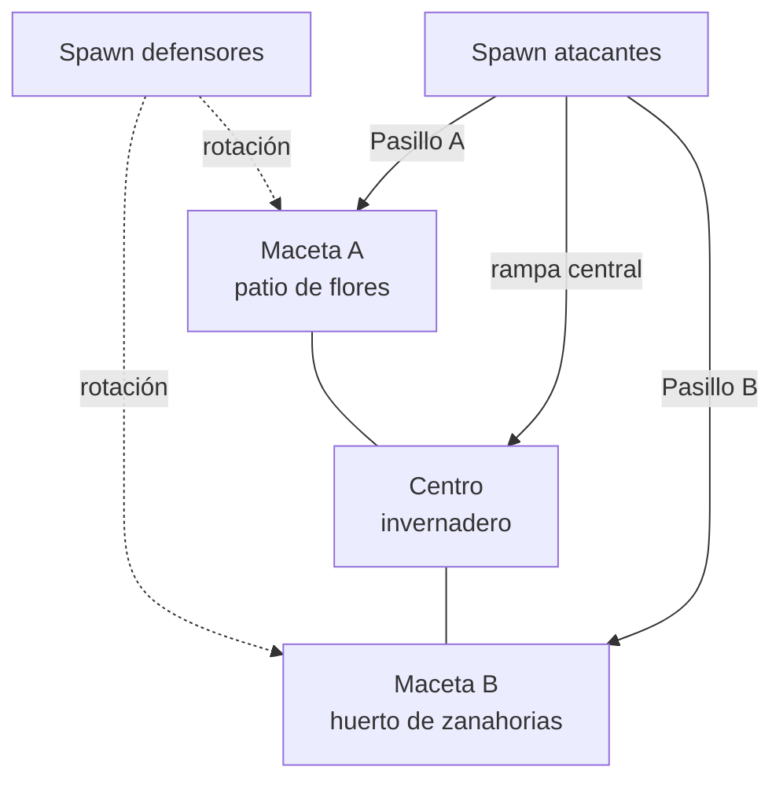
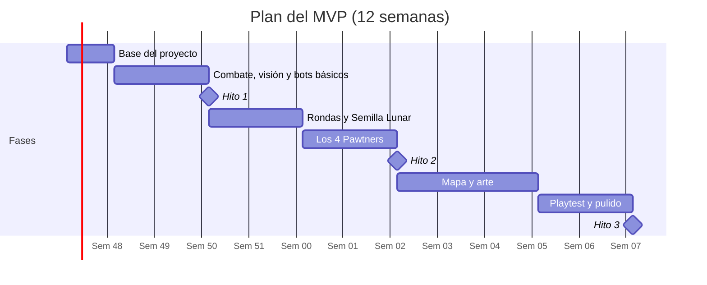

# GDD · Shooter táctico animal 2v2

Versión del 26 de noviembre de 2026.

## Índice

1. [Concepto](#concepto)
2. [Análisis de mecánicas de VALORANT](#análisis-de-mecánicas-de-valorant)
3. [Referencia visual y de cámara](#referencia-visual-y-de-cámara)
4. [Nombres: clase de personajes y juego](#nombres-clase-de-personajes-y-juego)
5. [Modo de juego: Semilla Lunar](#modo-de-juego-semilla-lunar)
6. [Reglas de partida 2v2](#reglas-de-partida-2v2)
7. [Roles y roster MVP](#roles-y-roster-mvp)
8. [Bots (IA)](#bots-ia)
9. [Controles, cámara y visión](#controles-cámara-y-visión)
10. [Mapa MVP: Huerto Lunar](#mapa-mvp-huerto-lunar)
11. [Dirección de arte y audio](#dirección-de-arte-y-audio)
12. [Arquitectura técnica en Godot 4](#arquitectura-técnica-en-godot-4)
13. [Plan de trabajo del MVP](#plan-de-trabajo-del-mvp)
14. [Riesgos y preguntas abiertas](#riesgos-y-preguntas-abiertas)

## Concepto

Un shooter táctico por rondas de 2 contra 2, con cámara cenital en 3/4 y animales chibi. Se juega con información, economía y habilidades, no con reflejos de puntería en primera persona.

- **Fantasía:** un dúo de animalitos adorables que, ronda a ronda, planea, compra y ejecuta jugadas con precisión.
- **Pilares:** 1) cada bala cuenta (poca vida, tiempo para matar corto); 2) la información vale más que la puntería (visión por línea de vista, sonido visible); 3) coordinación de dúo (dos roles complementarios); 4) lindo pero serio (estética tierna, decisiones tácticas reales).
- **Partida MVP:** 2v2, al mejor de 9 rondas (gana quien llega a 5), cambio de lado tras la ronda 4, unos 12–15 minutos.
- **Plataforma objetivo del MVP:** móvil (Android primero, luego iOS) con dos joysticks virtuales, en Godot 4. Teclado y ratón quedan solo para probar en PC.
- **Equipo:** un solo desarrollador. Por eso el MVP es offline: 1 jugador + 3 bots (1 aliado y 2 rivales). El online llega después del MVP.
- **Nombre de trabajo:** *Pawtners*. El nombre final no es prioridad por ahora.

## Análisis de mecánicas de VALORANT

La tensión de VALORANT sale de tres cosas: morir cuesta caro, la economía une una ronda con la siguiente y las habilidades sirven para conseguir o negar información antes de disparar. Esas tres se pueden llevar a vista cenital. La puntería a la cabeza y los ángulos verticales no se pueden y hay que reemplazarlos.

| Mecánica | Cómo funciona en VALORANT | Por qué funciona | Adaptación a vista cenital |
| --- | --- | --- | --- |
| Rondas y lados | 5v5, primero en ganar 13 rondas; cambio de lado a mitad; prórroga en empate | Cada ronda es un mini-partido con su propio plan | 2v2, primero a 5 rondas, cambio de lado tras la 4; muerte súbita en 4–4 |
| Sin respawn | Si mueres, quedas fuera hasta la siguiente ronda | Cada duelo pesa; jugar con cuidado tiene premio | Igual. En 2v2 perder a uno es perder la mitad del equipo, así que agregamos un rescate limitado (ver Reglas) |
| Economía | Créditos por kills, por ganar o perder y por plantar; se compran armas, escudos y habilidades | Une las rondas; aparecen las rondas de ahorro (eco) y las de compra completa | Moneda «croquetas» con la misma lógica, en números más chicos |
| Fase de compra | Unos 30 s antes de cada ronda, con barreras | Momento de planear con el equipo | 15 s, con menú radial |
| Objetivo asimétrico | Atacantes plantan la Spike en un sitio; defensores la desactivan | Obliga a atacar y fija dónde se pelea | Objetivo propio: la Semilla Lunar (ver Modo de juego) |
| Precisión por movimiento | Disparar corriendo es impreciso; hay que frenar para acertar | Premia el posicionamiento sobre el «run and gun» | Se mantiene tal cual: el cono de dispersión se abre al moverse y se cierra quieto o caminando |
| Retroceso y ráfagas | Patrones de retroceso; tiros controlados ganan | Habilidad mecánica que se aprende | El cono se abre con cada disparo seguido; ráfagas cortas son precisas |
| Disparo a la cabeza | Multiplicador de daño en la cabeza | Separa a los jugadores por puntería | No aplica desde arriba. Lo reemplaza el «tiro certero»: el primer disparo estando quieto hace +50 % de daño |
| Sonido como información | Pasos audibles; caminar es silencioso | Saber dónde está el rival sin verlo | El sonido se ve: ondas en pantalla donde suenan pasos y disparos fuera de tu visión; caminar no deja ondas |
| Visión y esquinas | Paredes tapan la vista; se «chequean» ángulos | Información oculta crea tensión | Niebla de guerra por línea de vista: solo ves lo que tu animal y tu compañero ven |
| Roles | Duelista, Iniciador, Controlador, Centinela | Cada uno cubre una necesidad del equipo | 2 roles que fusionan esas 4 funciones (ver Roles) |
| Habilidades | 4 por agente: 2 compradas, 1 gratis por ronda, 1 definitiva por puntos | Crean jugadas sin depender de la puntería | Misma estructura de 4 ranuras |
| Definitiva | Se carga con kills, muertes, orbes y plantar | Momentos decisivos que se planean | Se carga con kills, plantar o arrancar y recogiendo «tréboles» del mapa |
| Humo y control de zona | Humos tapan visión; muros, trampas y molotov niegan zonas | Permiten cruzar zonas abiertas | Funcionan aún mejor en vista cenital, porque la niebla de guerra ya es la base |

*Las cifras de VALORANT son aproximadas, escritas de memoria; sirven para comparar, no como fuente.*

## Referencia visual y de cámara

De la imagen de referencia tomamos el encuadre y la lectura, no los assets ni el estilo de ningún juego en concreto. Todo el arte será propio.

- **Cámara:** fija, en 3/4 cenital (unos 55–60° de inclinación), sin rotación, que sigue al jugador. Se adelanta un poco hacia donde apunta el ratón, para ver más en la dirección de disparo.
- **Arena cerrada:** un rectángulo con valla perimetral que marca el límite del mapa sin tapar el juego.
- **Coberturas en filas:** bloques repetidos (los barriles de la imagen) que forman pasillos, esquinas y líneas de tiro. En nuestro juego habrá dos tipos: *altas* (macetas grandes, cajas de zanahorias: tapan balas y visión) y *bajas* (fardos de heno, cercas cortas: tapan balas pero no visión).
- **Información sobre el personaje:** nombre, barra de vida con número y segmentos de munición flotando sobre la cabeza, legibles sin mirar el HUD. Lo mantenemos, y le sumamos la barra de escudo.
- **Zona de aparición:** una plataforma con color propio (la baldosa azul de arriba en la imagen) para indicar el spawn de cada equipo.
- **Anillo bajo el personaje:** círculo de color de equipo y del rango del arma; ayuda a leer posiciones rápido.
- **Cambio clave frente a la referencia:** en la imagen se ve todo el mapa. Aquí lo que está fuera de la línea de vista de tu dúo queda en niebla y no muestra enemigos; es la base de lo táctico.

## Nombres: clase de personajes y juego

Recomiendo **Pawtners** (*paw* + *partners*) para los personajes: dice «animal» y «compañero de dúo» a la vez, y encaja con el 2v2. Si prefieres un nombre en español, **Huellitas**.

| Nombre para la clase | Idea | A favor | En contra |
| --- | --- | --- | --- |
| **Pawtners** (recomendado) | Pata + compañero | Refuerza el dúo; fácil de recordar | Juego de palabras en inglés |
| **Huellitas** | Huellas de pata | Tierno, en español | Suena menos competitivo |
| **Bigotes** | Rasgo de muchos animales | Corto y con humor | No todos los animales tienen bigotes |
| **Guardianes Peludos** | Protectores del bosque | Encaja con el lore | Largo para la UI |
| **Critters** | Bichitos | Internacional | Muy usado en otros juegos |
| **Pelusas** | Bolitas de pelo | Muy chibi | Poco serio para un shooter |

Propuestas para el nombre del juego (hay que revisar marcas registradas y dominios antes de elegir):

- **Pawtners**: el nombre del juego y de la clase a la vez.
- **Bellota Táctica** / *Tactical Acorn*
- **Fluff & Fire**
- **Semilla Lunar**: por el objetivo del modo principal.
- **Paw Patrol** queda descartado: es una marca existente.

## Modo de juego: Semilla Lunar

Los atacantes siembran una Semilla Lunar en una de las dos macetas mágicas (A o B). Si la planta llega a florecer, ganan la ronda. Los defensores ganan si la arrancan antes o si eliminan a ambos atacantes antes de que siembren.

La base se parece a plantar y desactivar, a propósito, para mantener la tensión de VALORANT. Tres reglas propias la hacen distinta:

1. **La planta crece en 3 etapas visibles** (brote, tallo, flor), una cada 13 s; florece a los 40 s de sembrar. Todos ven en qué etapa va.
2. **Polen revelador:** en la etapa de tallo, la planta suelta polen que revela a cualquier enemigo dentro de 4 m durante 1 s, cada 3 s. Obliga a los defensores a entrar con un plan, no a esperar escondidos junto a la maceta.
3. **El arrancado no se pierde de golpe:** arrancar tarda 6 s. Si te interrumpen, el progreso se queda y baja un 10 % por segundo tras 2 s sin tocarla. Dos defensores pueden arrancar juntos y tardan 4 s.

Detalles:

- Sembrar tarda 3 s y se puede cancelar. Solo un atacante lleva la semilla; corre un 5 % más lento.
- Si el portador muere, la semilla cae al suelo y brilla; su posición la ven ambos equipos.
- Sembrar da +1 punto de definitiva al que siembra; arrancar da +1 al que la arranca.
- La ronda dura 75 s antes de sembrar. Al sembrar, el reloj pasa a los 40 s de crecimiento.

Alternativas descartadas para el MVP, por si las quieres probar después:

- **Robo del picnic:** los defensores cuidan dos cestas; los atacantes las «comen» canalizando 8 s, sin portador. Más simple, pero se parece a capturar una zona.
- **La bellota dorada:** una bellota neutral aparece en el centro y ambos equipos pelean por llevarla al árbol rival. Simétrico, pierde el ataque contra defensa de VALORANT.

## Reglas de partida 2v2

Cada animal tiene 100 de vida, sin regeneración, y un rifle mata en unos 4 impactos. Un error se paga con la ronda. Todos los números son de partida y se ajustan en playtest.

**Estructura**

1. Fase de compra: 15 s, con barreras que impiden salir del spawn.
2. Ronda: 75 s para sembrar. Al sembrar, 40 s de crecimiento.
3. Fin de ronda: 5 s con repetición de la última eliminación.
4. Partida: gana quien llega a 5 rondas. Cambio de lado tras la ronda 4. Con 4–4 se juega una ronda decisiva y el lado se sortea.

**Rescate de dúo (regla propia del 2v2)**

- Al morir, el animal deja un peluche de sí mismo durante 8 s.
- Su compañero puede abrazarlo 3 s para revivirlo con 30 de vida y sin escudo.
- Una vez por equipo y por ronda. Abrazar no permite disparar y hace ruido visible.
- Motivo: en 2v2 perder a uno deja a su compañero solo en un 1v2 casi perdido. El rescate abre una remontada arriesgada sin quitar el peso de morir.

**Economía en croquetas**

| Concepto | Croquetas |
| --- | --- |
| Inicio de partida y tras cambiar de lado | 800 |
| Ganar ronda | 1.500 |
| Perder ronda (1.ª / 2.ª / 3.ª seguida) | 900 / 1.100 / 1.300 |
| Por eliminación | 100 |
| Sembrar o arrancar (para todo el equipo) | 150 |
| Máximo acumulable | 5.000 |

Las armas sobreviven entre rondas si el animal sobrevive, igual que en VALORANT. Se puede comprar para el compañero.

La munición es infinita: no hay balas de reserva que comprar ni que se agoten. Solo existe el cargador, y recargar siempre lo llena; el tiempo de recarga es el costo.

**Armas del MVP**

| Arma | Tipo | Precio | Daño por impacto | Uso |
| --- | --- | --- | --- | --- |
| Pistola de burbujas | Pistola | Gratis | 22 | Inicial; precisa quieto |
| Tirachinas | Pistola pesada | 400 | 45 | Eco: dos impactos con tiro certero |
| Escopeta de confeti | Escopeta | 900 | 8 perdigones de 12 | Esquinas y macetas |
| Lanzaguisantes | Subfusil | 1.000 | 18 | Cadencia alta; castiga poco el movimiento |
| Rifle de semillas | Rifle | 1.700 | 30 | El arma de referencia |
| Ballesta de zanahoria | Francotirador | 2.400 | 110 | Un impacto mata sin escudo; recarga lenta |

| Protección | Precio | Escudo |
| --- | --- | --- |
| Caparazón ligero | 300 | +25 |
| Caparazón pesado | 800 | +50 |

**Precisión:** cada arma tiene un cono de dispersión. Quieto es el mínimo; caminando, ×1,5; corriendo, ×3; cada disparo seguido lo abre más. El primer disparo estando quieto es un tiro certero: +50 % de daño.

## Roles y roster MVP

El MVP trae 4 Pawtners, 2 por rol. Los dos roles fusionan las cuatro funciones de VALORANT, para que cualquier dúo tenga ataque, información y control.

| Rol | Función | Funciones de VALORANT que fusiona |
| --- | --- | --- |
| **Zarpa** | Entra primero, saca información y gana duelos | Duelista + Iniciador |
| **Madriguera** | Tapa visión, controla zonas y protege al dúo | Controlador + Centinela |

Se recomienda un dúo de un Zarpa y un Madriguera, pero no es obligatorio.

| Pawtner | Animal | Rol | Personalidad | Silueta clave |
| --- | --- | --- | --- | --- |
| **Mochi** | Gata calicó | Zarpa | Curiosa y presumida; siempre lleva un cascabel | Orejas grandes, cola en espiral |
| **Pip** | Conejo enano | Zarpa | Hiperactivo, habla rápido | Orejas largas, mochila con pala |
| **Tofu** | Panda | Madriguera | Dormilón y tranquilo; abraza su bambú | Cuerpo redondo, bambú a la espalda |
| **Capi** | Capibara | Madriguera | Calma total; lleva una naranja en la cabeza | Hocico ancho, naranja encima |

**Habilidades.** Cada Pawtner tiene 4 ranuras: C y Q se compran (máximo 1–2 cargas), E es gratis una vez por ronda y X es la definitiva, que se carga por puntos.

| Pawtner | Tecla | Habilidad | Coste | Efecto |
| --- | --- | --- | --- | --- |
| Mochi | C | Ovillo rebotón | 200 | Ovillo que rebota en coberturas; al detenerse revela enemigos a 5 m durante 2 s |
| Mochi | Q | Cascabel | 150 | Estalla y deja con 1 m de visión durante 1,5 s a quien apunte hacia él |
| Mochi | E | Salto felino | Gratis | Impulso de 4 m; se recupera al conseguir 2 eliminaciones |
| Mochi | X | Ojos nocturnos | 7 pts | 8 s viendo las huellas de todo enemigo que corra, en todo el mapa |
| Pip | C | Zanahoria señuelo | 100 | Genera ondas de pasos falsos durante 4 s |
| Pip | Q | Tierra al aire | 200 | Golpe al suelo: enemigos a 3 m quedan lentos y con dispersión ×3 durante 1,5 s |
| Pip | E | Madriguera rápida | Gratis | Viaja bajo tierra hasta 6 m, pasando bajo coberturas; deja un montículo visible |
| Pip | X | Gran salto | 7 pts | Salta a un punto visible a 15 m y aturde al caer en 4 m |
| Tofu | C | Muro de bambú | 200 | Muro de 6 m que dura 10 s; bloquea balas y visión; 300 de vida |
| Tofu | Q | Charco de miel | 150 | Zona de 3 m durante 6 s: frena un 40 % y hace visibles los pasos |
| Tofu | E | Nube de bambú | Gratis (2.ª: 100) | Nube de 3 m durante 14 s, colocada desde un mapa táctico; bloquea visión |
| Tofu | X | Siesta del bosque | 7 pts | Nube de 8 m durante 8 s; los enemigos dentro ven a 1 m |
| Capi | C | Naranja trampa | 150 | Trampa invisible a más de 3 m; al pisarla inmoviliza 1,5 s y revela |
| Capi | Q | Baño termal | 200 | Charco que cura a aliados 8 de vida por segundo, hasta 40 |
| Capi | E | Vigía tranquilo | Gratis | Pajarito sobre una cobertura que da visión en cono de 8 m; cae de 1 impacto; se recoge y se vuelve a poner |
| Capi | X | Calma total | 6 pts | Revive al compañero caído en esta ronda con 100 de vida; si está vivo, da 50 de escudo a ambos |

Roster para después del MVP (solo ideas): zorro ilusionista, búho de reconocimiento aéreo, erizo de trampas de púas, nutria con granadas de agua.

## Bots (IA)

Los bots completan los equipos para que un solo desarrollador pueda probar todas las mecánicas: en el MVP se juega 1 jugador + 1 bot aliado contra 2 bots rivales. Los bots usan el mismo `Pawtner` que el jugador; solo cambia quién controla.

- **Juegan limpio:** solo ven lo que ve su equipo (misma niebla de guerra) y oyen las mismas ondas de sonido. Nunca leen la posición real de un enemigo oculto.
- **Misma precisión:** disparan con el mismo cono que el jugador, así que también deben frenar para acertar.
- **Comportamiento por estados:**
    1. *Compra:* elige arma y habilidades según sus croquetas (reglas simples: eco, compra parcial, compra completa).
    2. *Avance:* va por la red de navegación hacia la maceta elegida (atacantes) o hacia su posición de guardia (defensores).
    3. *Combate:* al ver a un enemigo, frena, apunta con un tiempo de reacción y dispara en ráfagas; busca cobertura si pierde vida.
    4. *Investigar:* al ver ondas de sonido, va hacia ellas con cuidado (caminando).
    5. *Objetivo:* siembra si lleva la semilla; arranca la planta si defiende; protege a quien siembra o arranca.
    6. *Rescate:* si su compañero cae y no hay enemigos a la vista, va a abrazar el peluche.
    7. *Habilidades:* cada habilidad trae una regla de uso simple (por ejemplo, la Nube de bambú se lanza entre el bot y el enemigo visto).
- **Dificultad ajustable:** tiempo de reacción (0,25–0,6 s), error de puntería extra y agresividad. Sirve para probar el balance contra bots fáciles y difíciles.
- **Al bot aliado se le puede dar órdenes con el ping:** «voy», «enemigo» o «cuidado» cambian su objetivo.

## Controles, cámara y visión

La niebla de guerra por línea de vista es el sistema más importante del juego. Sin ella, la vista cenital muestra a todos y desaparecen la información oculta, los humos y los flanqueos.

El control principal es táctil. Teclado y ratón existen para probar en PC.

| Acción | Móvil (principal) | Teclado y ratón (pruebas) |
| --- | --- | --- |
| Moverse | Joystick izquierdo flotante (aparece donde tocas, en la mitad izquierda) | WASD |
| Caminar en silencio | Inclinar el joystick izquierdo menos de la mitad | Shift |
| Apuntar | Joystick derecho flotante; sin tocarlo, el animal mira hacia donde camina | Ratón |
| Disparar | Llevar el joystick derecho hasta el borde (más del 85 %): primero apuntas, luego empujas para disparar | Clic izquierdo |
| Apuntado fino | Botón de mira: cierra el cono y alarga la vista un 20 %, pero frena un 30 % | Clic derecho |
| Habilidades | 3 botones en arco sobre el joystick derecho, más la definitiva | C, Q, E; X |
| Sembrar o arrancar | Botón contextual que aparece en la maceta (mantener) | Mantener F |
| Recargar | Automática al vaciar el cargador, o botón | R |
| Comprar | Botón de tienda durante la fase de compra | B |
| Marcar en el mapa | Botón de ping con menú radial (enemigo, voy, cuidado) | Rueda del ratón |

**Cámara**

- 3/4 cenital fija, perspectiva con FOV cerrado (unos 35°) para que se parezca a una vista ortográfica sin perder volumen.
- Muestra unos 22 × 13 m alrededor del jugador.
- Se adelanta hasta 3 m hacia el cursor. Con apuntado fino, hasta 5 m.
- Las coberturas altas entre la cámara y el personaje se vuelven semitransparentes.

**Visión**

- Cada animal ve en 360° hasta 12 m, cortado por coberturas altas, muros y humos.
- Los dos miembros del dúo comparten visión.
- Lo que está fuera de visión se ve oscurecido, con el mapa visible pero sin enemigos ni proyectiles.
- Fuera de visión, correr y disparar generan ondas en el suelo durante 1 s, a 15 m (pasos) y 30 m (disparos).
- El servidor solo envía a cada cliente los enemigos que su equipo ve. Esto evita los hacks de visión (*maphack*).

## Mapa MVP: Huerto Lunar

El MVP tiene un solo mapa, Huerto Lunar: dos macetas, un centro que las conecta y dos pasillos. Es la estructura clásica de dos sitios, reducida para 4 jugadores. Los defensores llegan antes a cada maceta; los atacantes eligen por dónde entrar.

Propuesta de layout de unos 40 × 28 m, sin escala:

```
+----------------------------------------------------------------+
|                    [ SPAWN DEFENSORES ]                        |
|          .- - - - - - -'          '- - - - - - -.              |
|          v                                      v             |
|   +---------------+                     +---------------+      |
|   |   MACETA A    |                     |   MACETA B    |      |
|   | patio de      |    +-----------+    | huerto de     |      |
|   | flores  [#]   |----|  CENTRO   |----| zanahorias[#] |      |
|   |         [:]   |    |invernadero|    |   [:]         |      |
|   +---------------+    | [#]   [#] |    +---------------+      |
|          ^             +-----------+            ^              |
|   [:]    |  Pasillo A        ^      Pasillo B   |    [:]       |
|          |     [#]           | rampa     [#]    |              |
|          |                   | central          |              |
|          '-------- [ SPAWN ATACANTES ] ---------'              |
+----------------------------------------------------------------+

[#] cobertura alta (tapa balas y visión)   [:] cobertura baja (tapa balas)
---> ruta atacante   - - -> rotación defensora
```



Reglas de diseño:

- **Tiempos a pie (objetivo):** atacantes a cualquier maceta en unos 10 s; defensores en unos 6 s; rotar de A a B por el centro en unos 8 s.
- Cada maceta tiene 2 entradas y al menos una cobertura alta dentro, para que sembrar sea posible bajo fuego.
- Ninguna línea de tiro abierta de más de 18 m: la ballesta domina, pero no controla un pasillo entero.
- El centro es donde se gana el control del mapa: quien lo tiene rota más rápido.
- 2 tréboles (orbes de definitiva), uno en cada pasillo, que reaparecen cada 2 rondas.
- Todo en cuadrícula de 1 m, para montar el greybox rápido con GridMap y cambiarlo tras cada playtest.

## Dirección de arte y audio

Todo debe verse tierno de lejos y leerse claro en medio de un tiroteo. Si hay que elegir, la lectura gana a la decoración.

- **Proporción chibi:** cabeza de unas 2,5 veces el cuerpo, ojos grandes, patas cortas. Cada animal se reconoce solo por su silueta desde la cámara cenital (orejas, cola, accesorio).
- **Modelado:** low-poly con sombreado toon (2–3 tonos y borde suave). Unos 3–5 mil triángulos por personaje, para el renderer Mobile de Godot.
- **Paleta:** pastel cálido para el escenario (arena, verdes suaves, madera). Colores saturados solo para lo que importa: equipos (menta contra coral), habilidades y la Semilla Lunar (lila brillante).
- **Armas de juguete:** pistolas de agua, tirachinas, ballestas de zanahoria. Proyectiles visibles (burbujas, semillas, confeti) en vez de balas reales.
- **Muerte tierna:** el animal se desinfla en una nube de pelusa y queda su peluche. Nada de sangre.
- **Feedback:** números de daño con rebote, pequeño temblor de cámara, destello blanco al recibir un impacto.
- **Audio:** pasos distintos por animal (patitas, saltitos, pisadas pesadas). Cada habilidad suena distinto para aliados y enemigos. Música tranquila en la fase de compra y más intensa al sembrar.
- **UI:** redondeada y con iconos de patitas; nombre, vida, escudo y munición flotan sobre el personaje, como en la referencia.

## Arquitectura técnica en Godot 4

El proyecto ya está en Godot 4.7 con el renderer Mobile y física Jolt. Recomiendo 3D con cámara fija y jugabilidad en el plano XZ.

El MVP es offline: la partida corre entera en el teléfono, con el jugador y 3 bots. Aun así, el código se separa desde el día 1 en *intención* (qué quiere hacer cada Pawtner) y *simulación* (qué pasa en el mundo):

- Un `PlayerController` (táctil o teclado) y un `BotController` escriben la misma intención: moverse, apuntar, disparar, usar habilidad.
- El `Pawtner` solo lee esa intención y se simula igual sin importar quién lo controle.
- Cuando llegue el online, el `MatchManager` pasa a correr en un servidor y la intención viaja por la red. El diagrama de abajo muestra ese destino; en el MVP, «cliente» y «servidor» viven en el mismo dispositivo.

El servidor decide todo; cada cliente solo recibe lo que su dúo ve:

```mermaid
flowchart LR
    subgraph Cliente["Cliente (uno por jugador, 4 en total)"]
        CI["Entrada y predicción<br/>WASD, ratón, habilidades; mueve local"]
        CC["Cámara y niebla de guerra<br/>Camera3D 3/4; niebla con shader"]
        CH["HUD y tienda<br/>vida, munición, croquetas, compra"]
    end
    subgraph Servidor["Servidor autoritativo (headless)"]
        SM["MatchManager<br/>estados: compra, ronda, sembrada, fin"]
        SS["Semilla Lunar<br/>sembrar, crecer en 3 etapas, arrancar"]
        SE["Economía<br/>croquetas, compras, definitivas"]
        SV["Visión y relevancia<br/>línea de vista; solo envía lo visible"]
        SH["Resolución de impactos<br/>rebobina posiciones por latencia"]
    end
    subgraph Pawtner["Pawtner (CharacterBody3D): existe en servidor y clientes"]
        PH["Salud<br/>vida, escudo, rescate"]
        PW["Arma<br/>cono, cadencia, daño"]
        PK["Kit de habilidades<br/>C, Q, E, X como datos"]
        PV["Fuente de visión<br/>radio 12 m, pasos"]
    end
    D[("Datos (.tres)<br/>CharacterData · WeaponData · AbilityData · EffectData")]

    Cliente -->|"entradas (ENet + RPC)"| Servidor
    Servidor -->|estado visible| Cliente
    Cliente -->|controla y predice| Pawtner
    Servidor -->|simula con autoridad| Pawtner
    D -->|lee sus datos| Pawtner
```



- **Red (después del MVP):** `SceneMultiplayer` con `ENetMultiplayerPeer`. Servidor headless; en desarrollo, uno de los jugadores puede ser anfitrión.
- **Bots:** `BotController` con máquina de estados (avanzar, esperar, combatir, investigar) y caminos A* con `AStarGrid2D` sobre la misma cuadrícula de texto del mapa: no hay que hornear nada y es barato en móvil. Los bots consultan el mismo sistema de visión (`Perception`) que el jugador.
- **Móvil:** joysticks virtuales flotantes como `Control` en un `CanvasLayer`; renderer Mobile; objetivo de 60 FPS en un Android de gama media.
- **Movimiento:** el cliente predice su propio movimiento y corrige con el estado del servidor. A los demás jugadores los interpola entre instantáneas.
- **Impactos:** el servidor guarda unas 1 s de posiciones y «rebobina» a la latencia de quien disparó antes de resolver el impacto.
- **Relevancia:** `MultiplayerSynchronizer` con filtros de visibilidad (`add_visibility_filter`), para que cada cliente reciba solo los enemigos que su dúo ve.
- **Habilidades como datos:** cada habilidad es un `AbilityData` (.tres) que combina efectos comunes (proyectil, zona, revelar, ralentizar, curar, bloquear visión). Un personaje nuevo se arma sobre todo con datos, no con código nuevo.
- **Niebla de guerra:** el servidor calcula la visión con raycasts contra la capa de coberturas altas. El cliente la dibuja con una máscara en un `SubViewport` y un shader de oscurecido.

Estructura de carpetas propuesta:

```
res://
  core/        # MatchManager, Economy, Seed, Vision, HitResolver
  pawtners/    # pawtner.tscn + componentes; un subdirectorio por personaje
  weapons/     # WeaponData .tres + escenas de proyectil
  abilities/   # AbilityData .tres + efectos comunes
  maps/        # huerto_lunar.tscn (GridMap para greybox)
  ui/          # HUD, tienda, marcador
  bots/        # BotController, estados y reglas de uso de habilidades
  net/         # (después del MVP) lobby, conexión, sincronización
```

## Plan de trabajo del MVP

El MVP toma unas 12 semanas, en 6 fases, para un solo desarrollador. Es offline (1 jugador + 3 bots) y se prueba en Android desde la primera semana. El arte final llega recién en la semana 8: antes hay que probar que el combate con niebla funciona en greybox.

| Semanas | Fase | Contenido |
| --- | --- | --- |
| 1 | Base del proyecto | Movimiento con intención separada (jugador o bot), joysticks virtuales, cámara 3/4, greybox del mapa, primera build de Android |
| 2–3 | Combate, visión y bots básicos | Armas con cono de precisión, vida y escudo, tiro certero. Niebla de guerra y ondas de sonido. Bots que navegan, ven y disparan |
| ◆ | **Hito 1 · El 1v1 contra un bot con niebla es divertido** | 5 sesiones de prueba en el teléfono; si no engancha, se ajusta la visión antes de seguir |
| 4–5 | Rondas y Semilla Lunar | Estados de ronda, sembrar y arrancar, rescate de dúo. Economía en croquetas y tienda. Bots que siembran, arrancan, rescatan y compran |
| 6–7 | Los 4 Pawtners | Sistema común de efectos; kits de Mochi, Pip, Tofu y Capi; reglas de uso de habilidades para bots. Puntos de definitiva y tréboles |
| ◆ | **Hito 2 · Partida 2v2 completa contra bots en greybox** | Hasta 9 rondas de principio a fin en el teléfono, con los 4 personajes |
| 8–10 | Mapa y arte | Huerto Lunar final, modelos chibi, animaciones y efectos. Audio, UI táctil final e información sobre la cabeza |
| 11–12 | Playtest y pulido | Balance de armas, economía y habilidades; dificultad de bots. Rendimiento en móvil (60 FPS en gama media) |
| ◆ | **Hito 3 · MVP jugable** | Build de Android: 1 jugador + 3 bots; 15 partidas de prueba sin errores graves |

Después del MVP: multijugador online (servidor autoritativo), iOS y más Pawtners.



Si el Hito 1 falla, no se avanza a rondas: se itera la visión (radio, ondas de sonido, coberturas) hasta que el 1v1 enganche.

Primeras tareas (semana 1):

- [x] Escena `pawtner.tscn` con `CharacterBody3D`, movimiento y giro hacia donde se apunta
- [x] Rig de cámara 3/4 con adelanto hacia donde se apunta
- [x] Greybox de Huerto Lunar desde una cuadrícula de texto: macetas, centro, pasillos y coberturas
- [x] Intención separada del control: `PlayerController` hoy, `BotController` después
- [x] Joysticks virtuales flotantes (mover y apuntar)
- [x] Primera build de Android y prueba en un teléfono real
- [x] Navegación de bots generada desde la cuadrícula (A*)

Hecho de la fase de semanas 2–3 (combate, visión y bots básicos):

- [x] Armas como datos (`WeaponData`): pistola de burbujas, rifle de semillas y escopeta de confeti
- [x] Cono de precisión por movimiento, ráfaga (*bloom*), tiro certero (+50 %) e indicador del cono en el suelo
- [x] Vida, escudo, muerte y reaparición (partida de prueba con 2 s de protección)
- [x] Niebla de guerra por línea de vista compartida en el dúo; enemigos y proyectiles ocultos fuera de visión
- [x] Ondas de sonido por pasos (correr) y disparos fuera de visión
- [x] Bots que navegan, ven, oyen, investigan y disparan en ráfagas con tiempo de reacción y error de puntería
- [x] Partida de prueba 2v2 (tú + bot aliado contra 2 bots) con marcador
- [ ] Hito 1: 5 sesiones de prueba en el teléfono

Hecho de la fase de semanas 4–5, parte 1 (rondas, Semilla Lunar y rescate):

- [x] `MatchManager`: compra 15 s (congelados), ronda 75 s, fin de ronda 5 s; gana quien llega a 5; cambio de lado tras la ronda 4; ronda decisiva con lado sorteado
- [x] Semilla Lunar: la lleva un atacante (alterna cada ronda), cae al morir y se recoge; sembrar 3 s dentro de una maceta
- [x] Planta en 3 etapas (40 s), polen revelador en la etapa de tallo, arrancado 6 s (4 s entre dos) con progreso que decae
- [x] Rescate de dúo: peluche 8 s, abrazo 3 s, revive con 30 de vida, una vez por equipo y ronda, hace ruido
- [x] Botón táctil contextual (Sembrar / Arrancar / Rescatar) y tecla F en PC
- [x] Bots que llevan y siembran la semilla, recogen la caída, arrancan, rescatan y protegen la planta
- [x] HUD: marcador, ronda, rol, reloj, avisos de fase, estado de la planta y barra de interacción
- [ ] Parte 2: economía en croquetas, tienda táctil y bots que compran

## Riesgos y preguntas abiertas

El riesgo mayor es que el combate cenital con niebla no se sienta táctico. Por eso el primer hito valida eso antes de invertir en arte.

| Riesgo | Impacto | Mitigación |
| --- | --- | --- |
| La niebla de guerra se siente confusa o injusta | Alto: es la base del juego | Prototipo 1v1 en la semana 3; probar radios de 10, 12 y 14 m |
| Bola de nieve económica en 2v2 (con 2 jugadores, una ronda perdida pesa mucho) | Medio | Bonus por derrotas seguidas; tope de 5.000 croquetas |
| Bots poco creíbles o tramposos hacen que las pruebas no sirvan | Alto: son los únicos rivales del MVP | Mismas reglas de visión y precisión que el jugador; dificultad ajustable |
| Rendimiento en móviles de gama media (niebla, sombras, 4 personajes) | Medio | Renderer Mobile; probar en un teléfono real desde la semana 1 |
| Agregar el online después del MVP | Medio | Intención separada de la simulación desde el día 1 |
| Alcance para un solo desarrollador: 4 kits de 4 habilidades son 16 sistemas, más bots que los usen | Alto | Habilidades como recursos de datos sobre un sistema común de efectos |
| Parecerse demasiado a VALORANT o a los brawlers de referencia | Medio (legal y de identidad) | Nombres, personajes, arte, mapa y modo propios; ninguna habilidad copiada 1:1 |
| Que lo tierno reste legibilidad en combate | Medio | Regla: la lectura gana a la decoración; pruebas en escala de grises |

Decisiones tomadas (26 de noviembre de 2026):

- Plataforma: móvil, Android primero.
- Equipo: un solo desarrollador; los equipos se completan con bots.
- El rescate de dúo se mantiene.
- El nombre final del juego no es prioridad por ahora; se usa *Pawtners* como nombre de trabajo.

Preguntas abiertas:

- [ ] ¿Orientación horizontal fija? Se asume horizontal (*landscape*).
- [ ] ¿Qué teléfono Android de referencia se usa para medir rendimiento?
